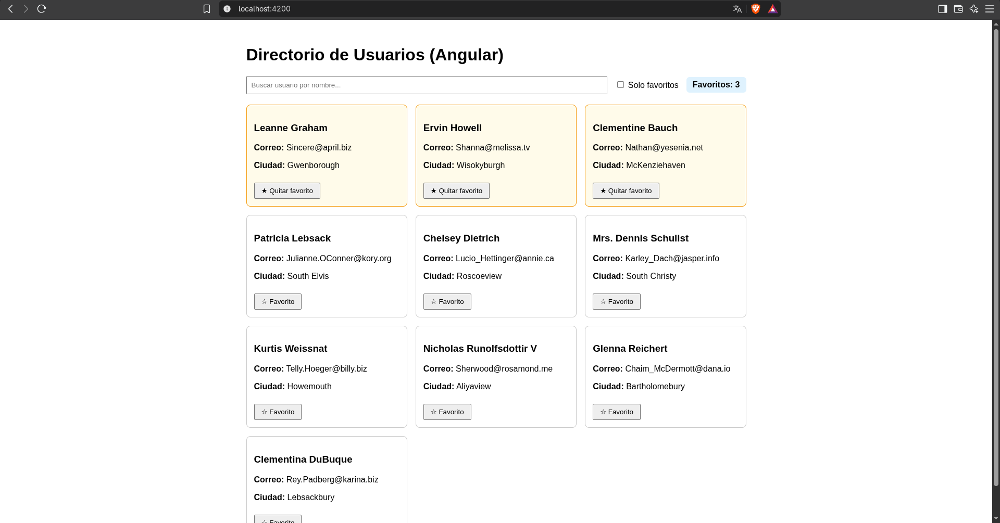
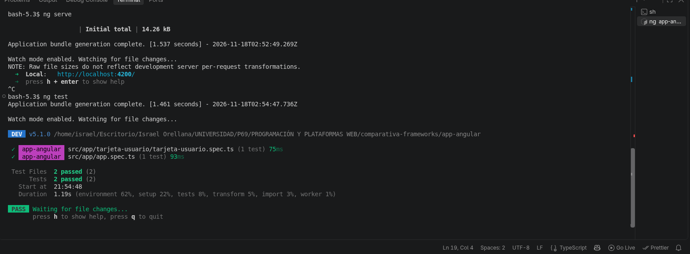
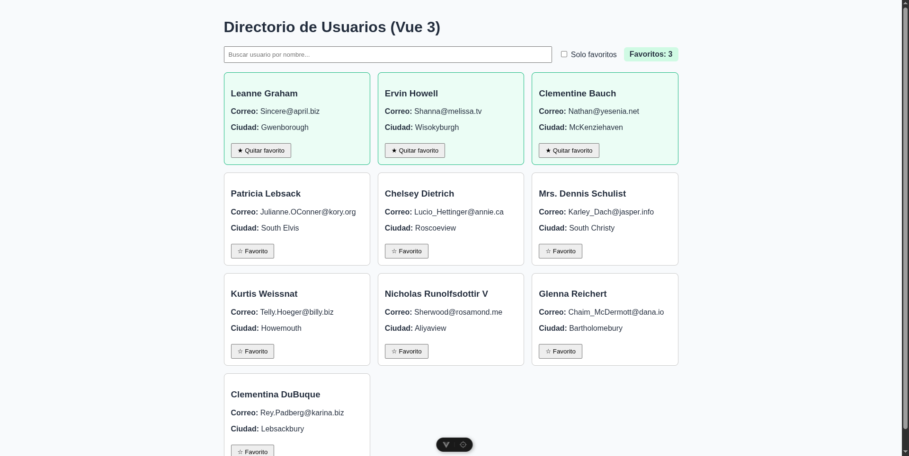
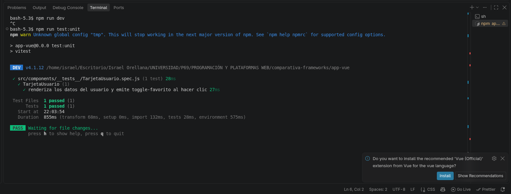

# Comparativa Práctica de Frameworks: Angular vs Vue 3

**Autor:** Israel Orellana  
**Repositorio:** `comparativa-frameworks`  
**API consumida:** `https://jsonplaceholder.typicode.com/users`

Aplicación de directorio de usuarios desarrollada en dos frameworks distintos (**Angular** y **Vue 3**) para comparar su arquitectura, manejo de estado, consumo de APIs y pruebas unitarias.

---

## Estructura del Repositorio

```text
comparativa-frameworks/
├── app-angular/       # Implementación en Angular (Componentes Standalone + HttpClient)
├── app-vue/           # Implementación en Vue 3 (Composition API + Fetch)
├── evidencias/        # Capturas de pantalla de ejecución y pruebas
└── README.md          # Documentación y comandos de ejecución
```

---

## Funcionalidades Implementadas (en ambas apps)

* **Consumo de API REST:** Consulta a `https://jsonplaceholder.typicode.com/users` con estados visuales de `"Cargando..."` y manejo de errores de red o HTTP.
* **Componente Reutilizable (`TarjetaUsuario`):** Muestra nombre, correo y ciudad (`address.city`), recibe propiedades desde el componente padre y emite eventos al marcar/desmarcar favoritos.
* **Gestión de Estado y Filtros:**
  * Búsqueda en tiempo real por nombre de usuario.
  * Botón interactivo **Favorito** en cada tarjeta con cambio visual de estado.
  * Contador dinámico **`Favoritos: N`**.
  * **Funcionalidad adicional:** Filtro mediante checkbox (`Solo favoritos`) para visualizar únicamente los usuarios marcados.
* **Pruebas Unitarias:** Pruebas automatizadas verificando el renderizado de datos y la emisión de eventos del componente tarjeta.

---

## 1. Aplicación en Angular (`app-angular`)

### Instalación y ejecución

1. Ingresar a la carpeta del proyecto e instalar dependencias:
   ```bash
   cd app-angular
   npm install
   ```
2. Levantar el servidor de desarrollo:
   ```bash
   ng serve
   ```
3. Abrir en el navegador: **`http://localhost:4200`**

### Ejecutar pruebas unitarias (Jasmine / Karma)

```bash
cd app-angular
ng test
```

---

## 2. Aplicación en Vue 3 (`app-vue`)

### Instalación y ejecución

1. Ingresar a la carpeta del proyecto e instalar dependencias:
   ```bash
   cd app-vue
   npm install
   ```
2. Levantar el servidor de desarrollo:
   ```bash
   npm run dev
   ```
3. Abrir en el navegador: **`http://localhost:5173`**

### Ejecutar pruebas unitarias (Vitest)

```bash
cd app-vue
npm run test:unit
```

---

## 3. Evidencias de Funcionamiento

### Angular (`app-angular`)
* **Aplicación en ejecución (búsqueda, favoritos y contador):**  
  

* **Prueba unitaria pasando (`ng test`):**  
  

### Vue 3 (`app-vue`)
* **Aplicación en ejecución (búsqueda, favoritos y contador):**  
  

* **Prueba unitaria pasando (`npm run test:unit`):**  
  